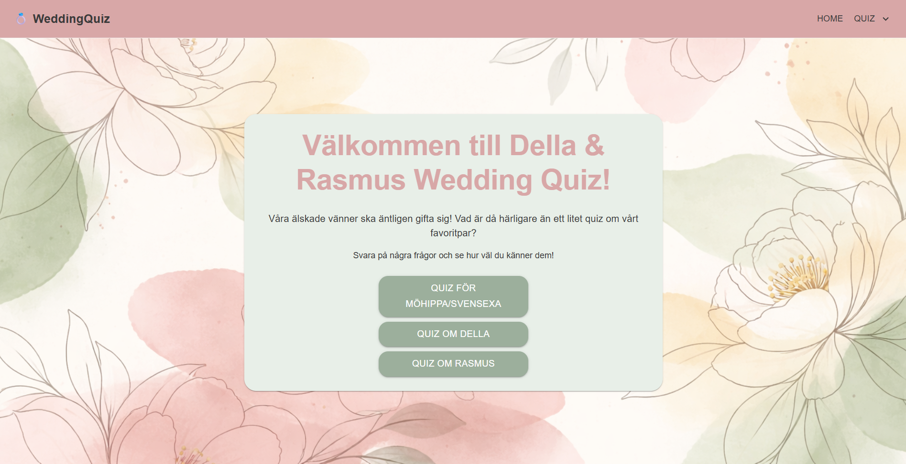
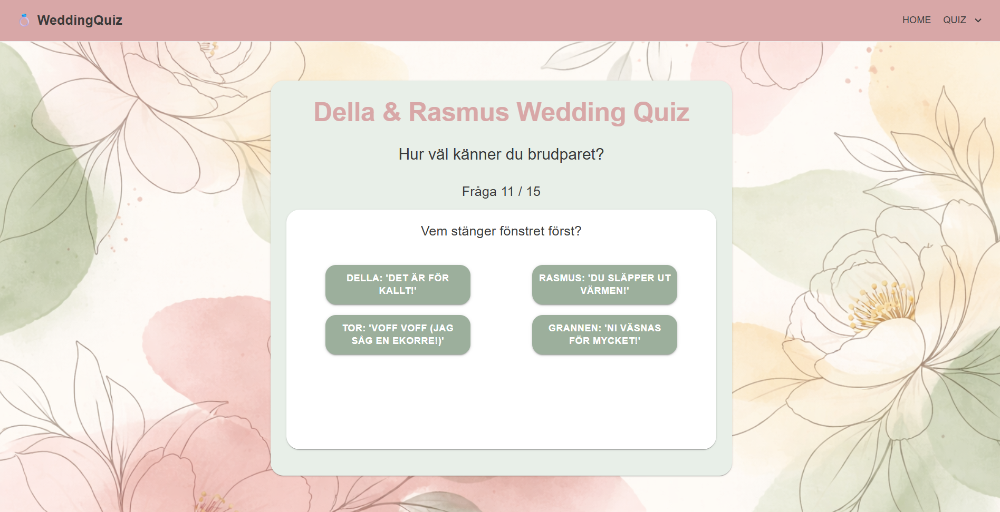

# 💍 WeddingQuiz

An interactive wedding quiz created for a friend's wedding, featuring personalized quizzes about the bride and groom.

<p align="center">
  <a href="https://amandarinen.github.io/WeddingQuiz/">
    <strong>Try the Wedding Quiz Live</strong>
  </a>
</p>

## About the Project

WeddingQuiz is a personal web development project created for a friend's wedding. The idea was to build something fun and interactive that would entertain the wedding guests and let them test how well they know the couple.

The application features three different quizzes: one about the couple together, one about the bride, and one about the groom.

The design was created specifically for the occasion, with a soft wedding-inspired color palette featuring dusty rose, sage green and pastel tones.

## Features

- **Three Different Quizzes** – Choose between a quiz about the couple, the bride or the groom.
- **Multiple Choice Questions** – Answer personalized questions about the couple.
- **Score Tracking** – Keep track of your score throughout the quiz.
- **Personalized Results** – Receive a customized message based on your final score.
- **Custom UI Design** – A wedding-inspired interface with a consistent color palette and styling.

## Screenshots

### Home Page


### Quiz


### Results


## Built With

- **C#**
- **.NET 8**
- **Blazor WebAssembly**
- **MudBlazor**
- **HTML & CSS**

## Live Demo

Try the application here:

[https://amandarinen.github.io/WeddingQuiz/](https://amandarinen.github.io/WeddingQuiz/)

## Getting Started

To run the project locally:

1. Clone the repository:

   ```bash
   git clone https://github.com/amandarinen/WeddingQuiz.git
   ```

2. Open the solution in Visual Studio.
3. Restore the NuGet packages.
4. Run the application.
